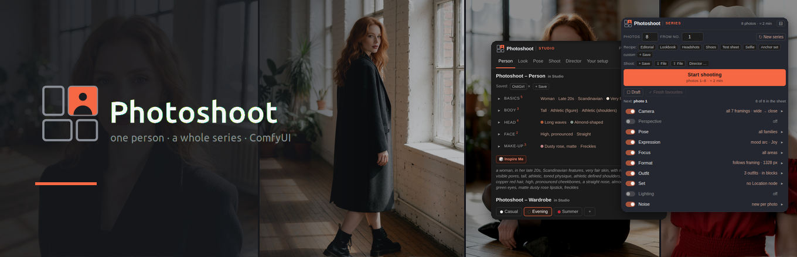
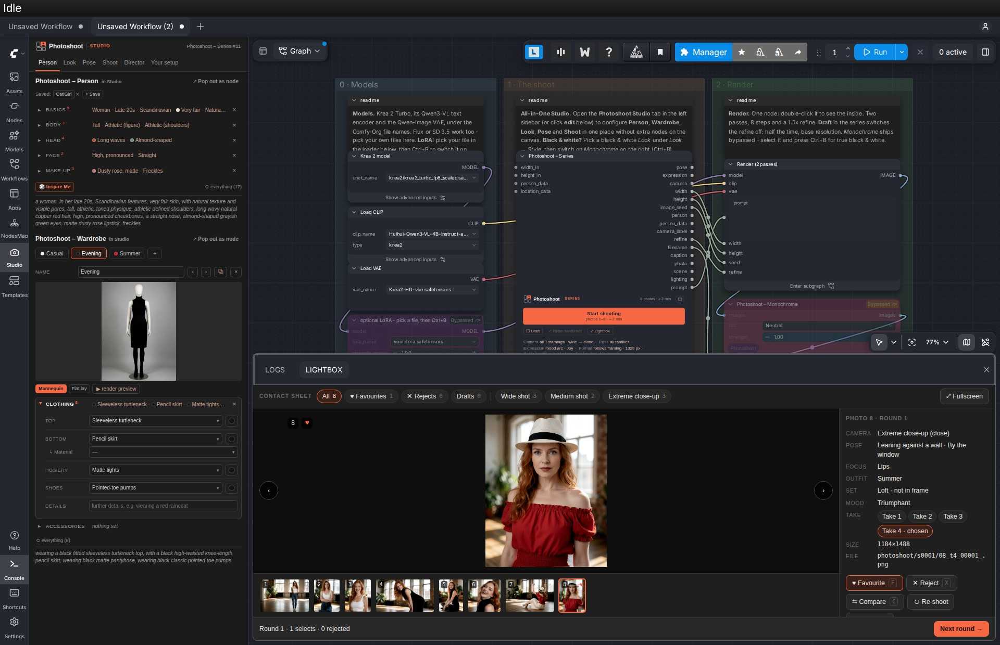
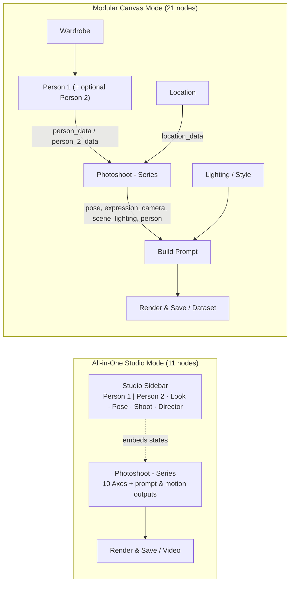
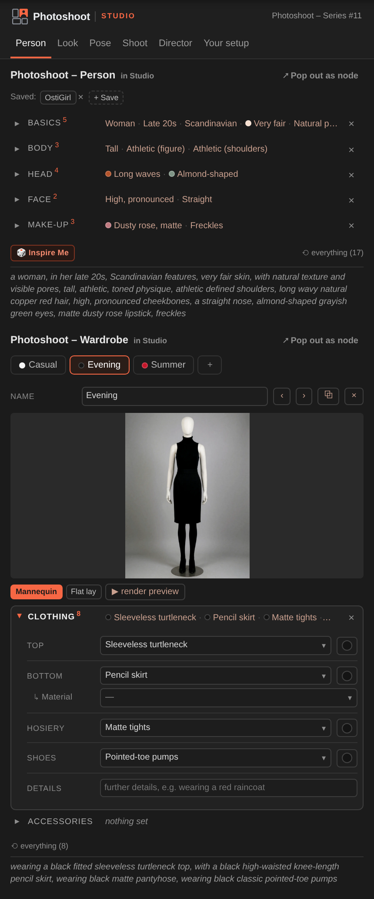
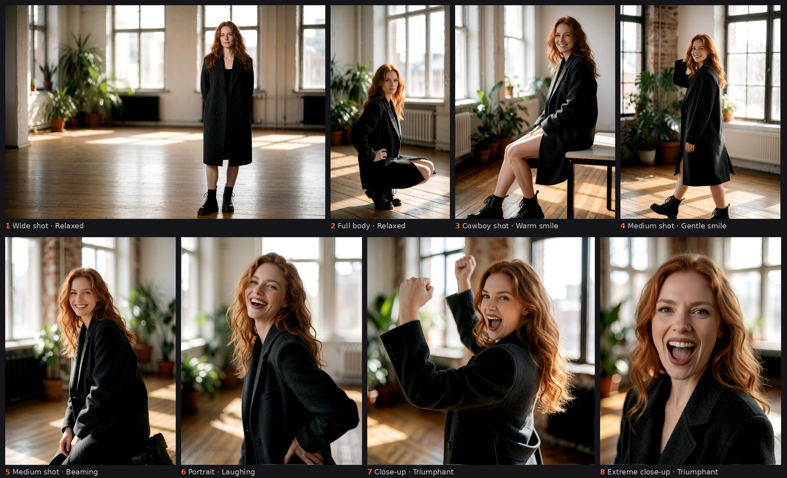
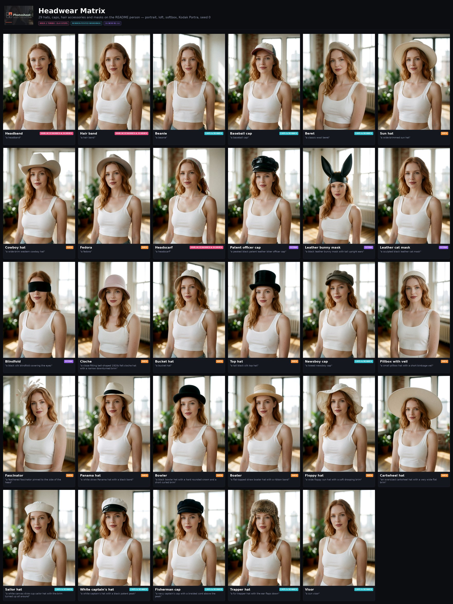
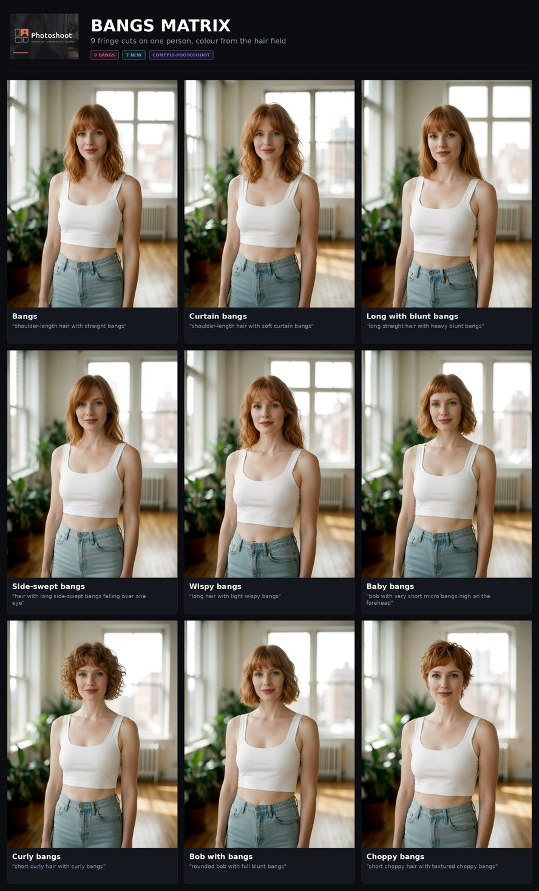
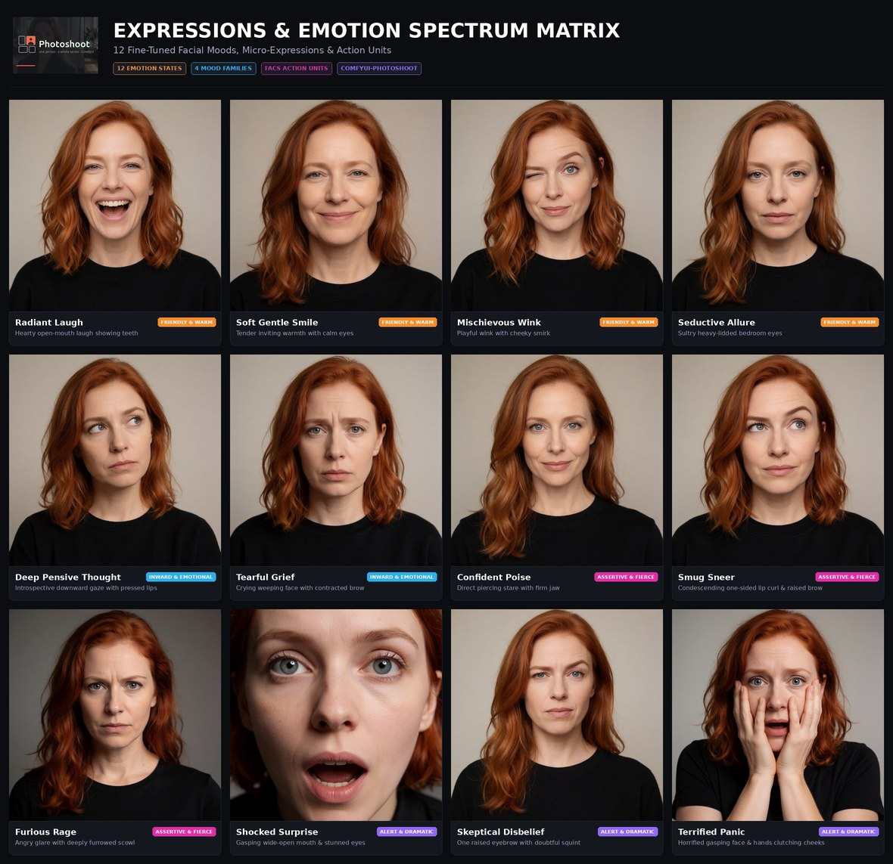

# Photoshoot

[](https://github.com/ralksta/ComfyUI-Photoshoot/releases)
[](CHANGELOG.md)
[](docs/quickstart.md)
[](docs/workflows.md)
[](docs/GUIDE.md)
[](docs/POSTERS.md)
[](https://github.com/ralksta/ComfyUI-Photoshoot/discussions/9)



**Quick jump:** [Install & Quickstart](#-installation--quickstart) · [How It Works](#how-it-works) · [Studio & Person](#studio-person-wardrobe--couples) · [10-Axis Series](#the-10-axis-series-lightbox--director) · [Reference Posters](#visual-reference-posters) · [Nodes](#all-22-nodes-at-a-glance) · [Docs](#documentation)

> [!IMPORTANT]
> **What's New in Release 3.1.0:**
> - **Comfy Desktop 1.2 & Multi-Build Ready:** Square pack icon (`docs/icon.svg`), `PHOTOSHOOT_USER_DIR` shared-folder env var, **1-click Workspace ZIP Backup/Import** & status card in *Studio → Your setup*, and shipped **Z-Image Turbo** workflow with 1-click Comfy-Org model download links.
> - **Quick-Shoot & Studio QoL:** New **Quick** launchpad tab, **🎲 Surprise Look**, per-tab **↺ Reset**, **Swap Person 1 ↔ 2**, and a collapsible **Live Prompt Preview** with word counter & block badges.
> - **Sedcard Portraits & Lightbox Actions:** Pin Lightbox renders (or upload photos) as character card thumbnails in *Casting-Deck*, filter cards by name, and copy finished **Prompt** or **I2V Motion** cues in 1 click from the Lightbox.
>
> **Full details:** [**Read the 3.1.0 Changelog →**](CHANGELOG.md)

**Build a person once. Now shoot 40 photos of her.** Photoshoot generates structured natural-language prompt series in ComfyUI — varying framing, perspective, pose, placement, mood, lighting, sets, outfits, aspect ratio, and seed while keeping the character consistent.



> [!NOTE]
> **Text nodes by design:** Every builder and Series node emits English prompt strings, pixel dimensions, and deterministic seeds (only *Photoshoot – Monochrome* touches pixels). Final visuals depend on your checkpoint, LoRAs, and sampler — posters and measurements here were rendered with **Krea 2 Turbo (fp8)** + **Qwen3-VL-4B** at 8 steps, CFG 1.0, 0 LoRAs.

---

## ⚡ Installation & Quickstart

No runtime dependencies beyond ComfyUI itself. Install via **ComfyUI Manager** (*Photoshoot*) or clone directly:

```bash
cd ComfyUI/custom_nodes
git clone https://github.com/ralksta/ComfyUI-Photoshoot
```

Restart ComfyUI, open **Templates → ComfyUI-Photoshoot**, and load one of five ready-to-run workflows (with Comfy Desktop 1.2 / ComfyUI model-download URLs embedded):

| Workflow | Style | Best for |
|---|---|---|
| [`photoshoot-studio.json`](example_workflows/photoshoot-studio.json) | **11 nodes** (All-in-One) | Everyday shooting via the left **Studio** sidebar & compact canvas Series node |
| [`photoshoot-studio-zimage.json`](example_workflows/photoshoot-studio-zimage.json) | **16 nodes** (Z-Image Turbo) | Fast 8-step single-pass Studio shoots (`Compact` framing profile, ~3 s/image) |
| [`photoshoot-studio-minimax.json`](example_workflows/photoshoot-studio-minimax.json) | **14 nodes** (MiniMax-H3 2K) | Native 2K single-pass Studio shoots in 6 Euler steps (`Compact` framing profile) |
| [`photoshoot-series.json`](example_workflows/photoshoot-series.json) | **21 nodes** (Modular) | Inspecting or wiring every builder independently on the canvas |
| [`photoshoot-reference-qwen21.json`](example_workflows/photoshoot-reference-qwen21.json) | **30 nodes** (Reference) | Generating multi-framing datasets (`NNNN.png` + `NNNN.txt`) from anchor images |

- New here? Follow the [**6-Step Quickstart →**](docs/quickstart.md)
- Working with LoRAs, Draft mode, Anchor sets & model setup? See [**Workflows & Character Consistency →**](docs/workflows.md)

---

## How It Works

Photoshoot splits **who** (*Person Builder*, *Wardrobe*) from **direction** (*Photoshoot Series*, *Pose*, *Expression*, *Location*, *Lighting*, *Style*), working identically in compact Studio mode or modular canvas mode:



Two principles keep long shoots coherent ([measured in detail](docs/measurements.md)):
1. **Deterministic Kronecker sequence:** Photo numbers map reproducibly to distinct seeds and field steps — extend a shoot from photo `13` or re-shoot just `Photo 7` (`↻ Re-shoot`) without changing the plan.
2. **Framing-coupled shortening:** Tight close-ups drop shoes and bottoms (`[above chest]`), while full-body and wide shots automatically shed micro makeup and nose/cheekbone tokens (`[figure]`, `[identity]`) so close facial details never force the camera back into a portrait.

---

## Studio, Person, Wardrobe & Couples



- **38 Person fields** in five sections (*Basics*, *Body*, *Head*, *Face*, *Make-up*) with combined single-phrase rows (hair + cut/colour, eyes + shape/colour, lips + finish), *Character LoRA trigger* & *Reference image* modes, and **🎲 Inspire Me** archetypes.
- **Wardrobe & live visual search:** Organize outfits as tabs with colour swatches, mannequin or flat-lay previews, and searchable two-column image pickers across tops, bottoms, footwear, eyewear, headwear, and hairstyles.
- **Couples / Two People (`Person 1 | Person 2`):** Switch between Person 1 and Person 2 right inside *Studio → Person* (each with an independent Wardrobe), toggle **Second person active**, and choose from five render-tested **Couple interactions** (`compose_couple` separates *left* vs *right* sentences cleanly so coat, shirt, and hair colours stay on their person).


<details>
<summary><b>Example: 17-field person composed and automatically shortened by framing</b></summary>

```text
[full]      a woman, in her late 20s, Scandinavian features, very fair skin, with natural
            texture and visible pores, tall, athletic, toned physique, athletic defined
            shoulders, long wavy copper red hair, high, pronounced cheekbones, a straight
            nose, almond-shaped grayish green eyes, matte dusty rose lipstick, freckles,
            wearing a charcoal wool coat, bare legs, wearing black combat boots

[figure]    … long wavy copper red hair, almond-shaped grayish green eyes, freckles,
            wearing a charcoal wool coat, bare legs, wearing black combat boots  (303 chars)

[identity]  … long wavy copper red hair, grayish green eyes, freckles, wearing a
            charcoal wool coat, bare legs, wearing black combat boots  (261 chars)
```

</details>

---

## The 10-Axis Series, Lightbox & Director


Every axis in **Photoshoot – Series** can vary across its family pools or lock still:

| Axis | What varies |
|---|---|
| **Camera** | 7 framings (*Extreme close-up* through *Wide shot*) + `wide → close` story order |
| **Perspective** | Off by default; 5 render-tested selfies (above, eye-level, lying down, mirror, over-the-shoulder) + 4 classic camera angles, coupled to single-hand/portrait constraints |
| **Pose** | 24 postures in 4 families + framing-coupled placement, orientation, arms, legs, tension & handheld props |
| **Expression** | 94 moods in 9 families, eyes, 4 gaze modes, brows, mouth, head tilt + mood arcs (*Joy*, *Dominance*, *Drama*) |
| **Focus** | 12 focal points coupled to valid framings |
| **Format** | 9 constant-pixel aspect ratios (e.g. full-body never lands 16:9 landscape), `1024–2560 px` |
| **Outfit** | Wardrobe costume changes in blocks or mixed |
| **Set** | Location node sets (**17 places**, **5 times of day**, **5 weather presets**, **4 seasons**), blocks or mixed, shortened behind the head on close framings |
| **Light** | 30 lighting setups matched to indoor vs outdoor sets, time-of-day arc (*morning → night*), or mixed |
| **Noise** | Fresh seed per photo or shared series seed (*Draft* skips pass 2 for 2× speed; *Takes* renders 2–4 takes per frame) |

- **Lightbox (`⤢`):** Full-width bottom panel with filters, `C` side-by-side compare, `F` favourite, `X` reject, **Finish favourites** (re-renders only keepers at full quality), and **Next round →** (iterates from selects only).
- **Director & Shoot files:** Describe a shoot in one sentence (or attach a reference photo in a vision chat LLM) to generate a complete validated shoot JSON (`photoshoot-shoot/1`) from built-in presets, or save/load entire setups (`docs/shoot_example.json`).



<details>
<summary><b>Inspect the 8-photo Joy series plan & assembled prompt</b></summary>

```text
 1  Wide shot        → Environment   Relaxed       1632×1088 [identity]
 2  Full body        → Whole figure  Relaxed        992×1776 [figure]
 3  Cowboy shot      → Upper body    Warm smile    1152×1536 [figure]
 4  Medium shot      → Environment   Gentle smile  1152×1536 [figure]
 5  Medium shot      → Upper body    Beaming       1152×1536 [figure]
 6  Portrait         → Eyes          Laughing      1184×1488 [full]
 7  Close-up         → Lips          Triumphant    1328×1328 [full]
 8  Extreme close-up → Lips          Triumphant    1184×1488 [full]
```

Sample output (`{style}, {expression}, {camera}, {scene}, {lighting}, {person}, {pose}`) on photo 8:
```text
editorial photography, 85mm lens, f/1.4, shallow depth of field, creamy bokeh,
an ecstatic triumphant woman shouting in victory, mouth wide open, eyes shining with joy,
extreme close-up macro shot of the lips and mouth, a sunlit loft with tall windows, …
```

</details>

---

## Visual Reference Posters

Every built-in wording was render-verified against a bare control (`docs/posters/`). Click any poster inside the drawers or browse all 14 sheets in [**Visual Reference Posters Catalogue →**](docs/POSTERS.md):

<details>
<summary><b>Wardrobe Matrices — Footwear (72), Tops (27), Bottoms (34), Bikinis (18) & Headwear (29)</b></summary>

[](docs/POSTERS.md)
[](docs/POSTERS.md#tops-matrix-27-tops)
[](docs/POSTERS.md#bottoms-matrix-34-skirts-shorts--trousers)
[](docs/POSTERS.md#bikini-matrix-11-tops-7-bottoms)
[](docs/POSTERS.md#headwear-matrix-29-hats-caps--accessories)

</details>

<details>
<summary><b>Lighting (30) & Style Looks Matrices (10 B&W + 7 Colour)</b></summary>

[](docs/POSTERS.md)
[](docs/POSTERS.md#black--white-looks-matrix-10-looks)
[](docs/POSTERS.md#colour-looks-matrix-7-looks)

</details>

<details>
<summary><b>Hairstyles (20 + 9 Bangs), Poses (18) & Expressions (12 Moods)</b></summary>

[](docs/POSTERS.md)
[](docs/POSTERS.md#bangs-matrix-9-fringe-cuts)
[](docs/POSTERS.md)
[](docs/POSTERS.md)

</details>

---

## All 22 Nodes at a Glance

| Node | Role |
|---|---|
| **Photoshoot – Person / Wardrobe** | 38 person fields (`person`, `person_data`) & multi-outfit tabs with preview mannequins |
| **Photoshoot – Series** | 10-axis planner, contact sheet, Lightbox, embedded Studio states, `person_2_data`, `prompt`, and I2V `motion` |
| **Photoshoot – Pose / Expression** | Standalone 24 postures + placement/limbs and 94 FACS-tested moods + gaze |
| **Photoshoot – Lighting / Style / Location** | 30 lights, 17 measured film/colour looks, and 17 sets (+ time of day, weather, season) |
| **Photoshoot – Build Prompt / Pick Blocks** | Template assembler (`{style}`, `{person}`, `{person1}`/`{person2}`…) & compact 4-in-1 selector |
| **Photoshoot – Monochrome / Save Dataset** | True B&W image post-process & LoRA training exporter (`NNNN.png` + `NNNN.txt`) |
| **Save / Load (Person, Scene, Style, Lighting, Prompt)** | 10 reusable preset-store nodes under `ComfyUI/user/krea2_*` |

### Custom Presets, Wording Lab & Locale

- **Extend live:** Click **+ Custom entry …** at the bottom of extendable dropdowns, import/paste packs in *Studio → Your setup* (`user/krea2_presets/`), or generate packs via `/krea2/custom/llm_prompt`.
- **Test before saving:** Use **Wording lab** under *Studio → Your setup* to test candidate English prompts against bare controls on 2 fixed draft seeds right in your workflow.
- **UI Locale:** Follows ComfyUI's language setting (English everywhere else, German when ComfyUI's locale is `de`; prompts stay English), or override directly via **ComfyUI Settings → Photoshoot → Language**.

---

## Documentation

| Guide | Covers |
|---|---|
| [**Quickstart**](docs/quickstart.md) | Install to finished series in 6 steps |
| [**Workflows, LoRAs & FAQ**](docs/workflows.md) | Example workflows, Draft mode, Anchor → Qwen-2.1 → LoRA pipeline, model support & FAQ |
| [**Full Node Reference**](docs/nodes.md) | Every node, coupling rule, Lightbox, Studio, Director & custom packs |
| [**Prompt Engineering Guide**](docs/GUIDE.md) | Empirical findings, FACS Action Units, token order & avoiding neutralizers |
| [**Visual Posters**](docs/POSTERS.md) | Full-resolution sheets for all categories |
| [**Measurements**](docs/measurements.md) & [**Internals**](docs/internals.md) | Quantitative tests, translation architecture, tests & ComfyUI targets |
| [**Changelog**](CHANGELOG.md) & [**Roadmap**](docs/ROADMAP.md) | Release history (`v3.0.0`) & planned features |

### Scope, Feedback & Licence

- **Scope:** Photoshoot describes adult subjects (built-in age presets start at early 20s; exact-age input has a minimum floor of 18).
- **Feedback:** Missing a garment, pose, or feature? Propose or upvote ideas in [**Discussions → What should Photoshoot do next?**](https://github.com/ralksta/ComfyUI-Photoshoot/discussions/9).
- **License:** MIT — see [LICENSE](LICENSE).
