# Photoshoot

[](https://github.com/ralksta/ComfyUI-Photoshoot/releases)
[](CHANGELOG.md)
[](docs/GUIDE.md)
[](docs/POSTERS.md)
[](https://github.com/ralksta/ComfyUI-Photoshoot/discussions/9)


> [!IMPORTANT]
> **Top 5 Changes in Release 2.9.0:**
> 1. **Photoshoot Studio sidebar, All-in-One workflow (`photoshoot-studio.json`) & Lightbox:** every node has a compact view (**⊟**/**⊞**); the *Studio* sidebar edits Person, Wardrobe, Look, Pose, Shoot and Director in one column starting on *Person* (plus pinned widgets of any node and single-node canvas shooting), and the *Lightbox* opens the contact sheet large with side-by-side compare, starring (**♥**), rejecting (**✕**) and *Next round from selects*.
> 2. **Inline custom presets, floating 2-column dropdowns & Studio pack manager:** unified styled dropdowns open as floating popovers with two-column image previews and `+ Custom entry …` at the bottom to add hairstyles, clothing, props, poses, lights and looks live without restarting ComfyUI; *Studio → Your setup* adds a `.json` pack loader and copy-paste LLM prompt generator.
> 3. **Draft mode, Finish favourites & live queue control:** switch *Draft* on in the Series to skip the refinement pass while exploring; star your keepers and click *Finish favourites* to re-render those exact photos — same framing, pose, outfit and noise seed — at full resolution, or stop/shoot single frames live.
> 4. **Director, Shoot files & Location set builder:** save and share a whole shoot as one JSON file, let *Director* plan a shoot from a sentence or reference photo, and rotate multiple sets and indoor/outdoor lighting via *Photoshoot – Location* and the Series **Set** / **Light** axes.
> 5. **Selfie mode, camera angles, handheld props & Qwen-Image-2.1 reference shoots:** added *Perspective* (selfie angles and classic camera angles), series **Gaze** modes, handheld props, the 1-click **Anchor set** recipe, and `photoshoot-reference-qwen21.json` with *Photoshoot – Save Dataset*.
>
> **New here?** Pick [`example_workflows/photoshoot-studio.json`](example_workflows/photoshoot-studio.json) for a compact single-node Studio workflow, or [`example_workflows/photoshoot-series.json`](example_workflows/photoshoot-series.json) for all builders side by side. The [**Quickstart**](docs/quickstart.md) gets you from install to your first series in six steps.
>
> [**Read full changelog →**](CHANGELOG.md)

**You built a person. Now shoot 40 photos of her.**

> [!NOTE]
> **These nodes write text.** Every node here produces an English prompt string —
> person, pose, expression, lighting, style, framing — and hands it to your
> sampler. What the picture finally looks like is decided by your model,
> checkpoint, LoRAs, resolution and sampler settings. The posters and
> measurements in this repository were rendered with Krea 2 Turbo (fp8) and
> Qwen-VL at 8 steps, CFG 1.0, no LoRA (the tops and bottoms sheets add the
> refinement pass of the example workflows); another model will read the same
> words differently. The one node that touches pixels is *Photoshoot – Monochrome*.

Photoshoot is a set of ComfyUI nodes in two halves. The **Person Builder** describes
someone across 38 fields — body, face, hair, make-up — and saves them under a
name; the **Wardrobe** dresses her, one outfit per tab. The **Photoshoot** turns
that person into a whole series: every
photo a different framing, pose, placement, expression and aspect ratio, while
the person stays the same. Set the count, press the button, and the node queues
all 40 runs itself.


*The All-in-One Studio workflow (`example_workflows/photoshoot-studio.json`):
the **Photoshoot Studio** sidebar on the left edits Person, Wardrobe, Look,
Pose, Shoot and Director in one column; the compact Series node on the canvas
plans and queues the shoot; and the **Lightbox** at the bottom reviews takes,
favourites and round selection (or pick
[`photoshoot-series.json`](example_workflows/photoshoot-series.json) for all
builders side by side).*


## Building a person

38 fields in five collapsible sections. You pick labels; the node writes English. Related fields
share a row — hair and its colour, eye shape and eye colour, lips and finish —
because they are merged into one phrase and you need to see both while setting
either. A long list opens under its row instead of as a dropdown: type to
filter it, by German or English name or by the prompt text, star your
favourites, and the ones you used last sit on top. For clothes, shoes,
hairstyles and headwear the list shows a picture of the entry under the
pointer, so you can tell a milkmaid top from a Bardot top before you pick one:
clothes, shoes and hats alone on the Wardrobe's neutral mannequin (shoes close
up from the side, so the heel shows), hairstyles on the README person.

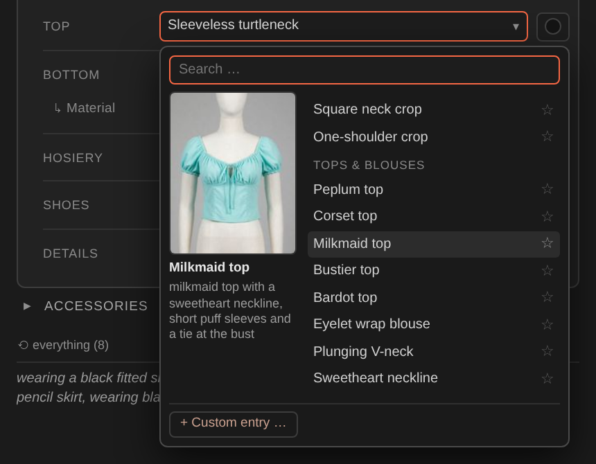

With a **character LoRA**, put its trigger into *LoRA trigger* under Basics:
the face, hair and make-up then come from the LoRA, and the person only adds
age, body and the outfit — a short person block, which is also what lets moods
show (see the photoshoot's mood arcs).

A person with seventeen fields set, in a Wardrobe with one outfit:

```text
Basics    Woman · Late 20s · Scandinavian · Very fair · Natural pores
Body      Tall · Athletic · Athletic shoulders
Head      Long waves + Copper red · Almond-shaped + Greyish green
Face      High, pronounced cheekbones · Straight nose
Make-up   Dusty rose + Matte · Freckles

Wardrobe  Coat: Bare legs · Combat boots + Black · wearing a charcoal wool coat
```

That produces one string, and the eye shape and colour have become a single
phrase rather than two competing ones:

```text
a woman, in her late 20s, Scandinavian features, very fair skin, with natural
texture and visible pores, tall, athletic, toned physique, athletic defined
shoulders, long wavy copper red hair, high, pronounced cheekbones, a straight
nose, almond-shaped grayish green eyes, matte dusty rose lipstick, freckles,
wearing a charcoal wool coat, bare legs, wearing black combat boots
```

The same person seen from further away — this is what the Photoshoot sends for a
full-body shot, and for a wide one:

```text
[figure]    … long wavy copper red hair, almond-shaped grayish green eyes,
            freckles, wearing a charcoal wool coat, bare legs, black combat boots
            (cheekbones, nose and lipstick dropped — 303 chars instead of 376)

[identity]  … long wavy copper red hair, grayish green eyes, freckles,
            wearing a charcoal wool coat, bare legs, black combat boots
            (eye shape and shoulders dropped too — 261 chars)
```

Nothing is lost: the builders keep every field and still show them. Only
what gets sent shrinks with distance, because tokens the camera cannot resolve
still pull the composition onto the head.

### Dressing her: the Wardrobe

Clothes are not part of the person. The **Wardrobe** holds the outfits of a
shoot as tabs — top, bottom and material, hosiery, shoes, jewellery, glasses,
headwear, each colour a button next to its field — and goes into the Person
Builder's `wardrobe` input. The person wears the open tab; in a series she
changes through all of them (see the *Outfit* axis). *Render preview* shows an
outfit on its own, on a faceless mannequin or as a flat lay.


*Person and Wardrobe together in **Photoshoot Studio** (`Person` tab): three
outfits as tabs, the open one's mannequin preview, and its Clothing section
with colour buttons. The composed English sentences sit directly below each
builder and update as you click — or pop either out onto the canvas with one
click.*

<details>
<summary><b>View Visual Footwear & Shoe Matrix (72 Models Poster)</b></summary>
<br>

[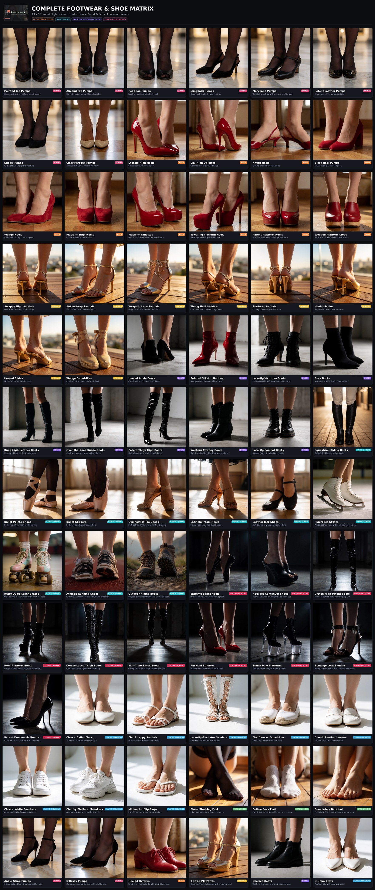](docs/POSTERS.md)

*Click image or visit the **[Visual Reference Posters Catalogue](docs/POSTERS.md)** for full-resolution sheets & all categories.*

> [!NOTE]
> *ComfyUI-Photoshoot builds precision prompt tokens and framing instructions. Visual output depends on your diffusion model and checkpoint (rendered above with Krea2 Turbo fp8 + Qwen-VL, 8 steps, 0 LoRAs).*

<br>
</details>

<details>
<summary><b>View Tops, Bottoms, Bikini & Headwear Matrices (27 Tops, 34 Skirts, Shorts & Trousers, 18 Bikinis, 29 Headwear)</b></summary>
<br>

[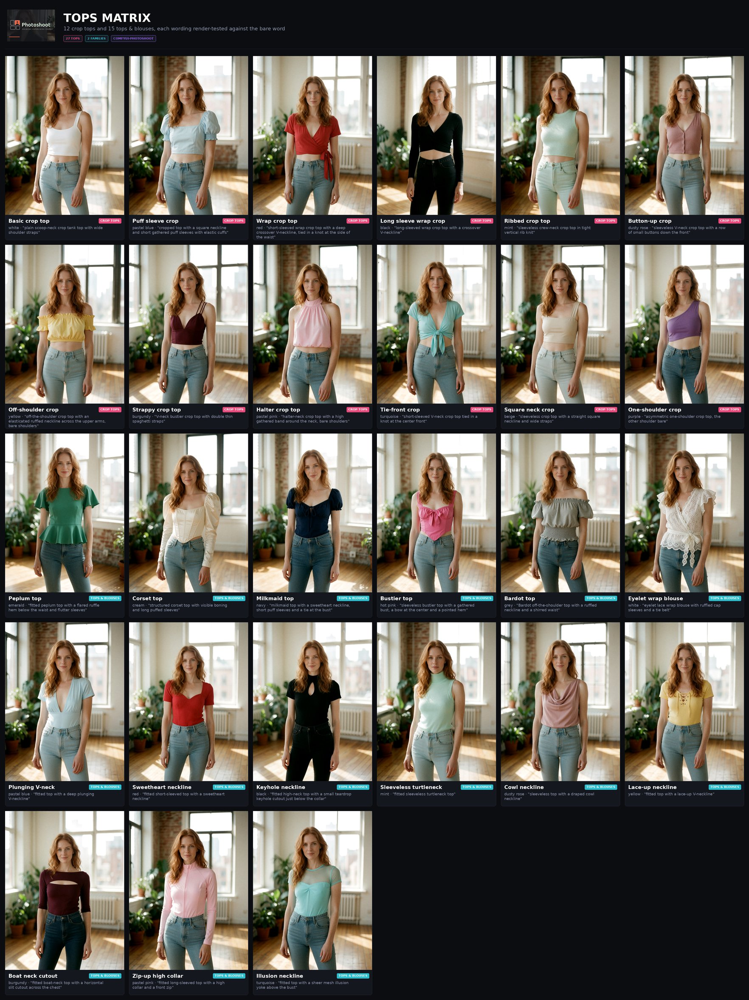](docs/POSTERS.md#tops-matrix-27-tops)

[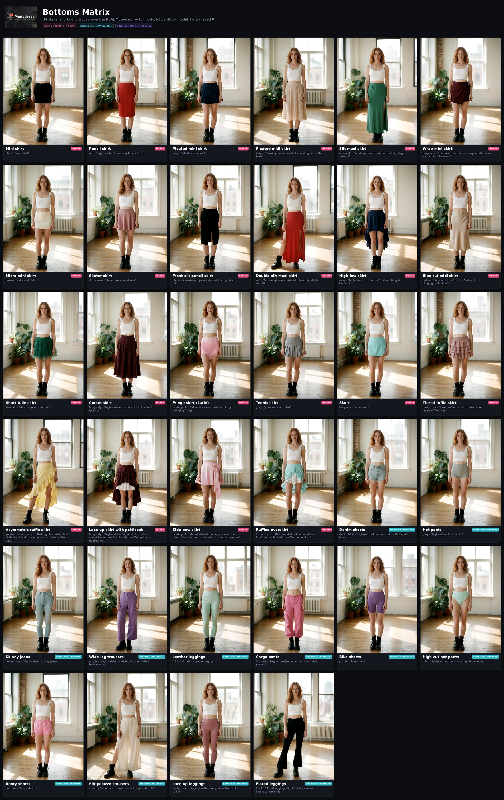](docs/POSTERS.md#bottoms-matrix-34-skirts-shorts--trousers)

[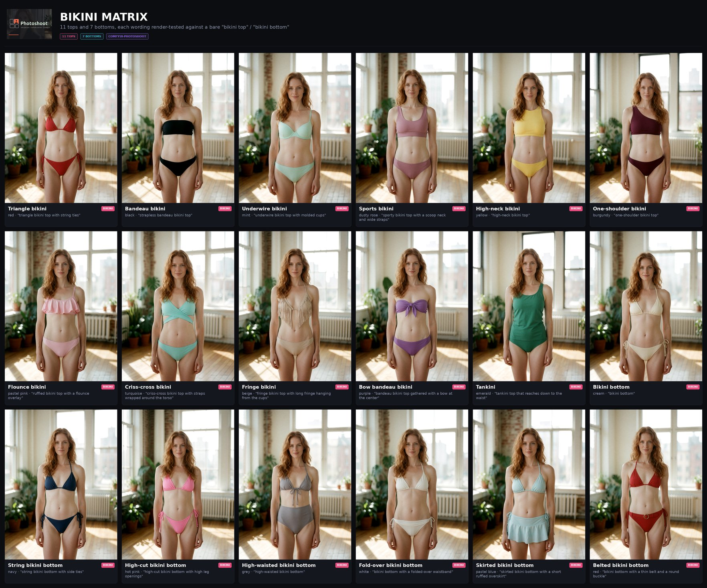](docs/POSTERS.md#bikini-matrix-11-tops-7-bottoms)

[](docs/POSTERS.md#headwear-matrix-29-hats-caps--accessories)

*The person from this README, photo 1 of the series, the same loft and light every time; only the garment and its colour change. Krea2 Turbo fp8 + Qwen-VL, two-pass, 0 LoRAs.*

<br>
</details>

<details>
<summary><b>View Visual Lighting & Atmosphere Matrix (30 Setups Poster)</b></summary>
<br>

[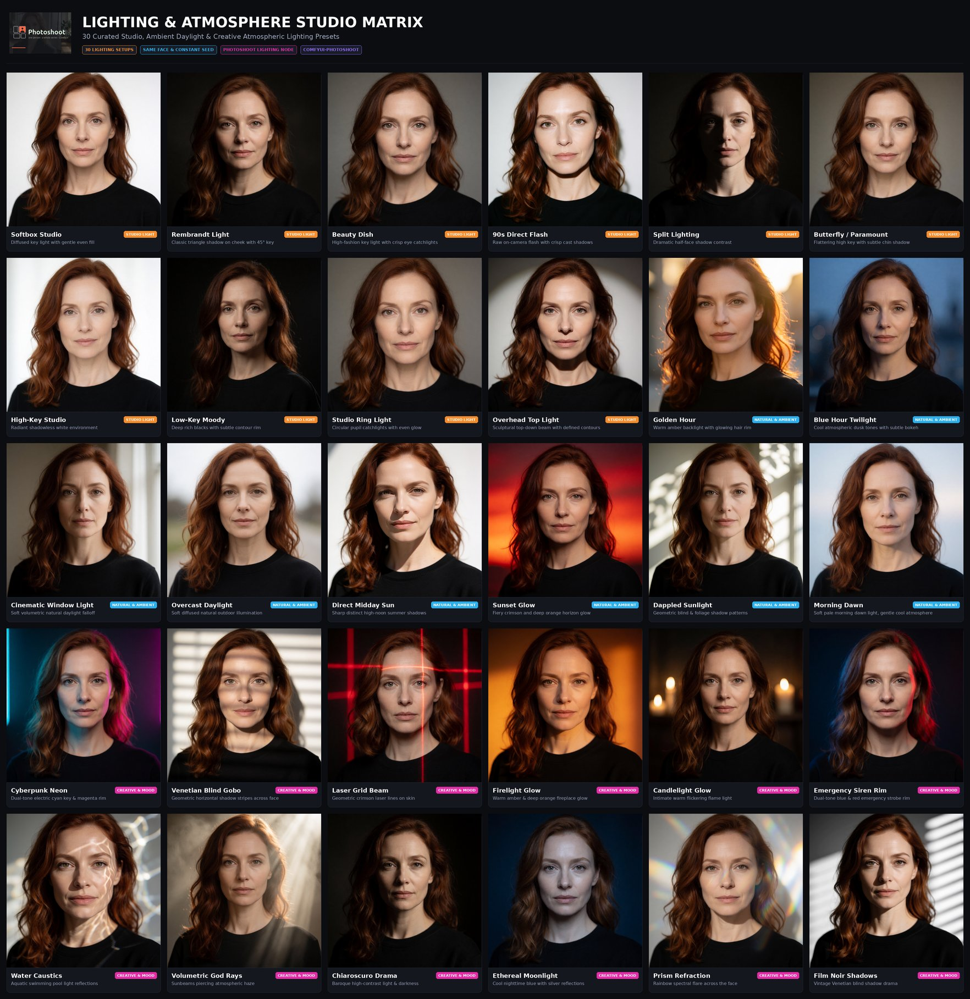](docs/POSTERS.md)

*Click image or visit the **[Visual Reference Posters Catalogue](docs/POSTERS.md)** for full-resolution sheets & all categories.*

<br>
</details>

<details>
<summary><b>View Visual Style Looks Matrices (10 Black & White + 7 Colour Posters)</b></summary>
<br>

[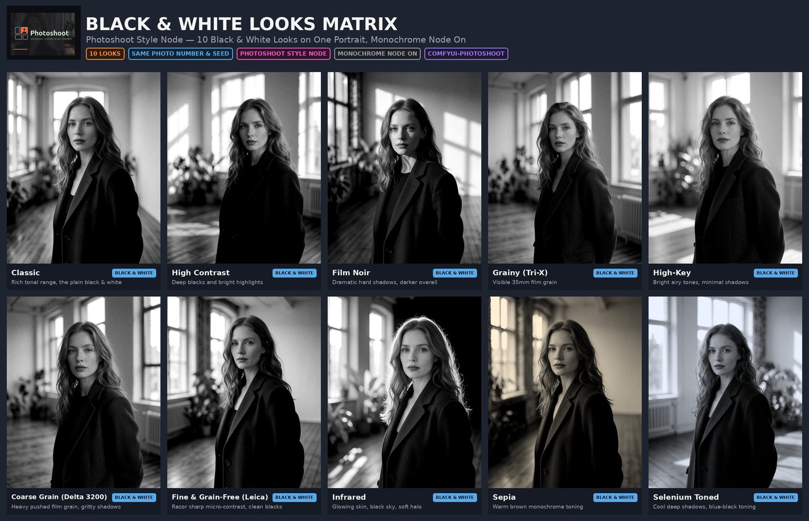](docs/POSTERS.md#black--white-looks-matrix-10-looks)

[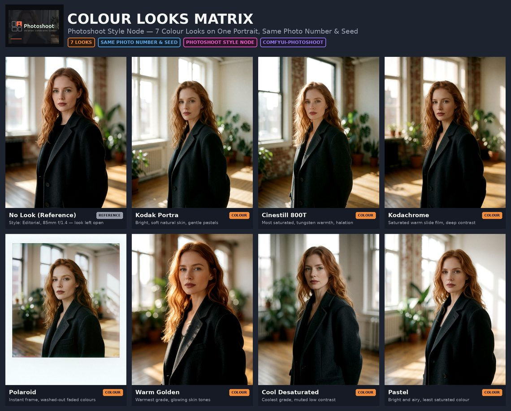](docs/POSTERS.md#colour-looks-matrix-7-looks)

*Click image or visit the **[Visual Reference Posters Catalogue](docs/POSTERS.md)** for full-resolution sheets & all categories.*

<br>
</details>

<details>
<summary><b>View Visual Hairstyles & Bangs Matrices (20 Presets, 9 Bangs)</b></summary>
<br>

[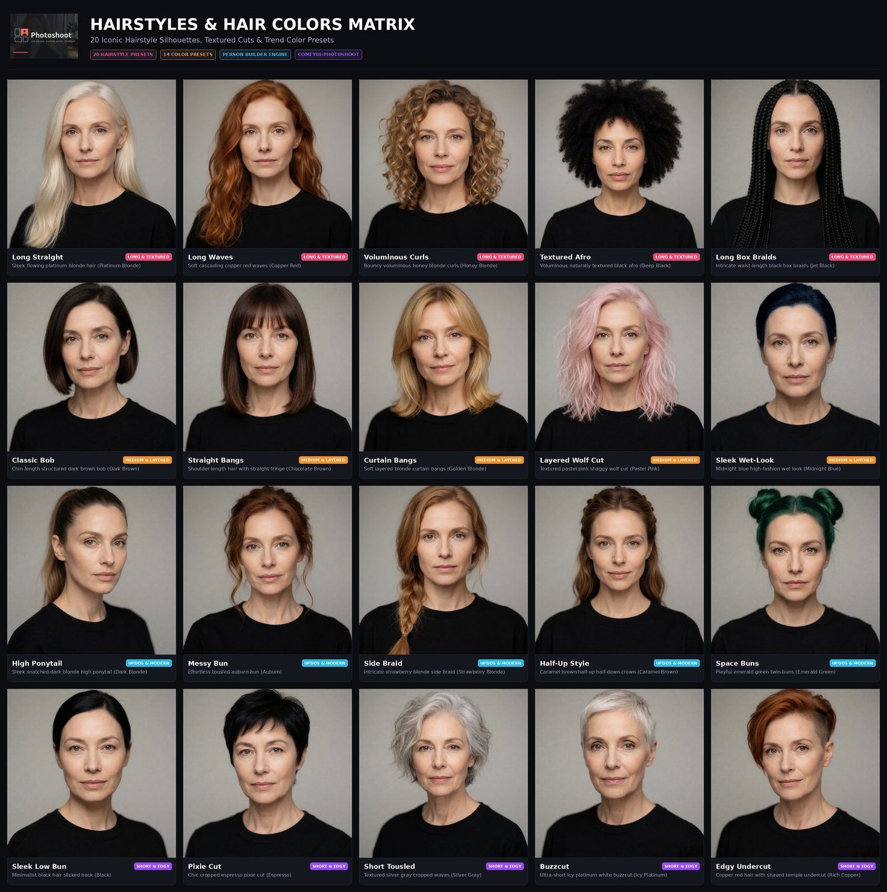](docs/POSTERS.md)

[](docs/POSTERS.md#bangs-matrix-9-fringe-cuts)

*Click image or visit the **[Visual Reference Posters Catalogue](docs/POSTERS.md)** for full-resolution sheets & all categories.*

<br>
</details>

<details>
<summary><b>View Visual Poses & Postures Reference Guide (18 Postures Poster)</b></summary>
<br>

[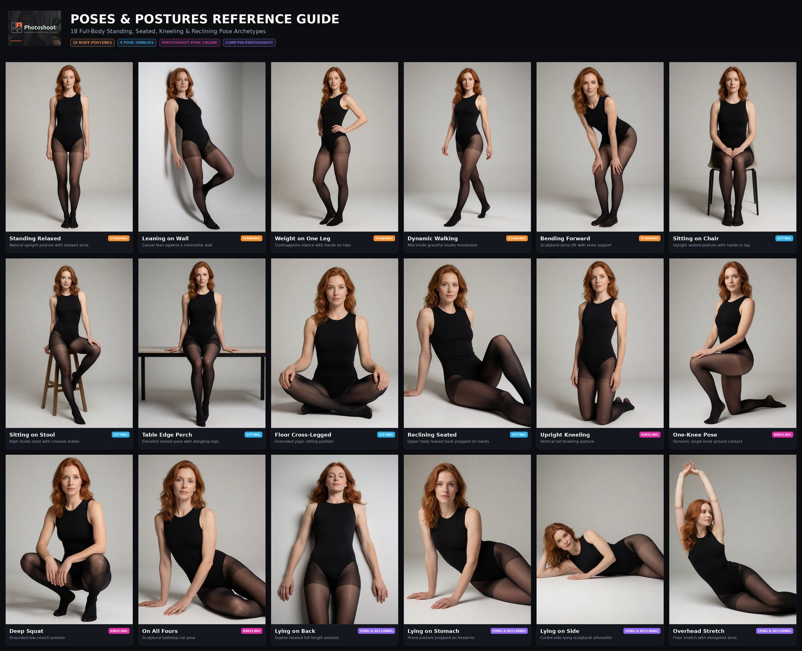](docs/POSTERS.md)

*Click image or visit the **[Visual Reference Posters Catalogue](docs/POSTERS.md)** for full-resolution sheets & all categories.*

<br>
</details>

<details>
<summary><b> View Visual Expressions & Emotion Spectrum (12 Moods Poster)</b></summary>
<br>

[](docs/POSTERS.md)

*Click image or visit the **[Visual Reference Posters Catalogue](docs/POSTERS.md)** for full-resolution sheets & all categories.*

<br>
</details>

## The photoshoot

Ten axes. Each can be switched off — then it holds still — or restricted to a
family: *only standing poses*, *only calm moods*, *only close-ups*.

| Axis | What varies |
|---|---|
| **Camera** | 7 framings, extreme close-up through wide shot |
| **Perspective** | off by default; on, the camera angle after the framing — so far four render-tested selfies (from above, eye level, lying down, mirror), each with a hand free for the phone and a phone's 9:16 or 4:5 |
| **Pose** | 24 postures in 4 families, plus placement in the room, orientation, arms, legs, tension — placement is coupled to the framing and tension to the posture, so no photo asks for a figure that is leaning against a wall and curled up at once |
| **Expression** | 94 moods in 9 families, plus eyes, gaze, mouth, brows, head tilt |
| **Focus** | 12 focal points, face to feet — coupled to the framing, since a wide shot does not focus on the lips |
| **Format** | 9 aspect ratios at a constant pixel count, coupled to the framing so a full-body shot never lands in 16:9 landscape — plus the size, from 1024 to 2560 px |
| **Outfit** | costume changes from the person's Wardrobe, in blocks or mixed — in blocks, each outfit is shot wide to close |
| **Set** | set changes from a **Location** node — *loft → street → café* — in blocks or mixed; close framings get only what is behind the head |
| **Light** | off by default; on, one of the 30 lighting setups per set, over the series as a time of day (morning → night), or mixed — outdoor light only on outdoor sets |
| **Noise** | a fresh seed per photo, or one seed for the whole series to keep the setting recognisable |

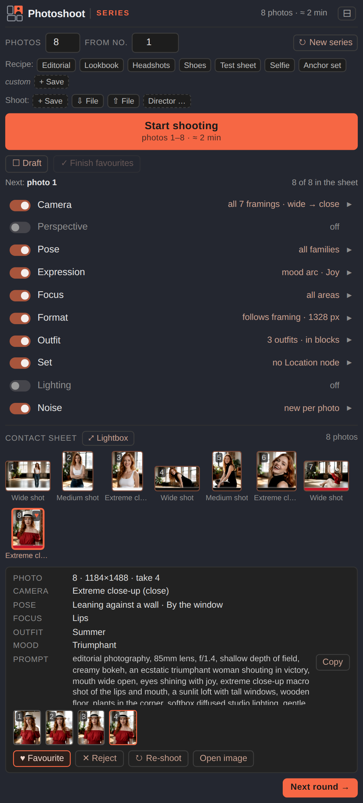

**Recipes** set all axes for a kind of shoot in one click — *Editorial*,
*Lookbook*, *Headshots*, *Shoes* and a seven-photo *Test sheet* with every
framing exactly once. Under Camera, *wide → close* turns the series into a shoot that opens wide and
ends in the detail; under Expression, a **mood arc** (*Joy*, *Dominance*,
*Drama*) lets the mood develop from photo to photo instead of jumping — *Joy* shows without a LoRA, the darker two want a character LoRA ([why](#what-a-series-looks-like)) — and **gaze** decides whether the eyes meet the camera: *mixed*, *at the camera*, *mostly camera* or *away*. *+ Save* keeps your own settings next to them — the exact
series, start number included, to load again later.

The node ends in a **contact sheet**: every photo as a frame in its real aspect
ratio, filled with the picture once it is rendered, 24 to a page. Click a
frame for its framing, pose, focus, mood and the exact **prompt** it got (with
a copy button), mark it as a **favourite**, or mark it for a
**re-shoot** — the same plan with new noise, as many takes as you like, while
the rest of the series stays as it is. With *takes per photo* every shot is
rendered two to four times from the start, and you pick the take per photo.
The sheet remembers its pictures in the workflow, so it survives a restart of
ComfyUI. Every panel edit is one step for Ctrl+Z.

**Lightbox.** For a closer look, *⤢ Lightbox* (or a double-click on a frame)
opens the sheet big in ComfyUI's bottom panel: one photo at full size, filters by
favourite, reject, draft and framing, a side-by-side compare, and the keys
← → F X C to go through a round quickly — the same favourites, takes and
re-shoots as the node, which follows every change.
[Details](docs/nodes.md#lightbox)

**Studio sidebar.** *Studio* in ComfyUI's left icon bar puts the whole shoot
into one column: Person, Look, Pose, Shoot and Director as tabs, each the
node's own panel on the same state, the lighting setups and postures as
picture tiles. *Your setup* holds any widget of your graph you pin there with
a right-click — a LoRA loader's file and strength, say.
[Details](docs/nodes.md#studio-sidebar)

**Compact nodes.** ⊟ in a panel's brand strip makes it short: the Series
keeps *Start shooting*, *Draft*, one line of what its axes do and a strip of
its photos (a click opens the Lightbox there), the Person her summary and
*Inspire Me*, the builders one line per field; a click on a summary opens it
in the Studio sidebar. New nodes and the example workflows start compact,
older workflows open as they were; nothing of it reaches the prompt.
[Details](docs/nodes.md#compact-view)

Then the photographer's loop: shoot, select, reshoot. Star the photos that
work (and, if you like, mark the ones that do not with *✕ Reject*), press
**Next round →**, and the next series starts right after this one, drawing
only from the framings, pose and mood families, focus areas and outfits of
your selects. *Round 2 · based on 3 selects* says where you are, and *← back
to round 1* brings the previous round back with its favourites and takes.

**Shoot files and the Director.** The row *Shoot:* under the recipes keeps the
whole shoot — person, outfits, light, look, series, scene and prompt template —
as one JSON file: save it under a name, download it to share, open one someone
sent you. A preview shows what goes into which node before anything changes,
and *Undo* takes it back. *Director …* turns one sentence into a whole shoot
through any chat LLM: copy the prompt it builds, paste it into ChatGPT, Claude,
Gemini or a local model, paste the answer back. The LLM only picks from the
built-in, render-tested lists — it never writes prompt text — and a second mode
reverse-engineers a reference photo in a vision chat the same way.
[Details](docs/nodes.md#shoot-files) · [example file](docs/shoot_example.json)

Two things make this a series rather than 40 random images.

**It counts, it does not roll dice.** Run 7 always produces the same photo, so a
series is reproducible and you can extend it later. Counting uses a Kronecker
sequence — each field steps by the fractional part of a different square root —
because plain integer factors made fields with related list lengths march in
lockstep: the same body turn kept arriving with the same mouth.

**The person shrinks with distance.** The prompt for a wide shot drops lipstick,
eyeliner and brow shape and keeps the silhouette. Those tokens are invisible at
that range but still pull the composition back onto the head.
[More on that](docs/nodes.md#framing-wins-over-description).

## What a series looks like


Eight photos of one series, unretouched: *wide → close* under Camera, the
*Joy* arc under Expression, everything else drawn. Same person throughout —
the hair, the freckles, the charcoal coat and the black boots come from the
Person Builder and do not drift. The camera moves in from the wide shot to the
extreme close-up while the mood goes from relaxed to triumphant; the pose, the
place in the room and the aspect ratio change with every photo.

The plan behind it, as the contact sheet shows it:

```text
 1  Wide shot        → Environment   Relaxed       1632×1088 [identity]
 2  Full body        → Whole figure  Relaxed        992×1776 [figure]
 3  Cowboy shot      → Upper body    Warm smile    1152×1536 [figure]
 4  Medium shot      → Environment   Gentle smile  1152×1536 [figure]
 5  Medium shot      → Upper body    Beaming       1152×1536 [figure]
 6  Portrait         → Eyes          Laughing      1184×1488 [full]
 7  Close-up         → Lips          Triumphant    1328×1328 [full]
 8  Extreme close-up → Lips          Triumphant    1184×1488 [full]
```

Every photo is a plain prompt. With the example template
`{style}, {expression}, {camera}, {scene}, {lighting}, {person}, {pose}`,
photo 8 comes out as:

```text
editorial photography, 85mm lens, f/1.4, shallow depth of field, creamy bokeh,
an ecstatic triumphant woman shouting in victory, mouth wide open, eyes shining
with joy, extreme close-up macro shot of the lips and mouth, a sunlit loft with
tall windows, wooden floor, plants in the corner, softbox diffused studio
lighting, …, in her late 20s, Scandinavian features, very fair skin, … long
wavy natural copper red hair, high, pronounced cheekbones, a straight nose,
almond-shaped grayish green eyes, matte dusty rose lipstick, freckles, wearing
a charcoal wool coat, bare legs, wearing black combat boots
```

The mood is the subject — "an ecstatic triumphant woman" — and the person joins
it without a second "a woman". Photo 7 cheers "with both fists raised in the
air"; in the macro the fists are left out, because a gesture outside the frame
pulled the extreme close-up back to a full figure. The `[full]` / `[figure]` /
`[identity]` tag is the detail level: photo 1 is so far away that cheekbones,
nose, eye shape and lipstick are left out, photo 8 carries all of them.

> [!NOTE]
> **Which arc works without a LoRA.** With the person described in full, as
> here, Krea 2 renders smiles, laughter and cheering reliably — *Joy* comes
> through. The darker arcs do not: in the same series with *Drama* the
> gestures showed (a hand over the mouth, hands in the hair) but the faces
> stayed calm, and "crying" came out without a tear. With a character LoRA,
> whose trigger replaces the face description, the person block is short and
> frightened, panicked and desperate faces came through in the tests; tears
> did not, with or without.

## Wiring

```text
Wardrobe ──► Person Builder ──person_data──► Photoshoot ──┬── person   ─┐
 outfits     38 fields, saved once          the series  ├── pose      │
                                                        ├── expression├──► Build Prompt ──► your sampler
                                                        ├── camera    │
Scene / Style ──────────────────────────────────────────┴── width/height/seed
```

1. **Build a person.** 38 fields in five sections, and a Wardrobe with her
   outfits on its `wardrobe` input. Save under a name and reuse across
   sessions — the point is that the same person comes back.
2. **Send them to a photoshoot.** Set the count, restrict the axes you care
   about, then press **Start shooting** in the node's own panel — that button,
   not the Queue button above the canvas. Queue renders one run, the photo the
   panel calls *next*; *Start shooting* sets the counter to the start number
   and queues the whole series. A new start number is a new series with the
   same settings — *↻ New series* draws one.
3. **Assemble the prompt.** Placeholders (`{camera}`, `{person}`, `{pose}` …)
   drop the parts into your own text, or the node appends them in a sensible
   order if you have none.

Pose and expression also work as standalone nodes when you do not want a series.

For set changes, a **Location** node goes into the Series' `location_data`
input; wire the Series' `scene` (and, with the light axis on, `lighting`)
outputs into Build Prompt in place of the fixed scene and the Lighting node.
[Details](docs/nodes.md#sets-and-light)

### Already have your character?

Then leave step 1 out. The Person Builder is optional — unwire it and the
`{person}` placeholder simply drops from the prompt, no stray commas, and the
Photoshoot node varies framing, pose, placement, expression and aspect ratio
around whoever your character already is:

```text
close-up shot, with the focus on the neckline, walking, near a window, torso
turned away, looking back over the shoulder, arms wrapped around the knees,
knees together, feet apart, back arched, a soft gentle smile, eyes closed,
looking past the camera, furrowed brows, pursed lips, head tilted slightly
```

That is a whole series' worth of direction with no description of a person in
it. Whatever holds your character — a LoRA and its trigger word, an IPAdapter
reference, an identity-preserving edit model — supplies the who, and these
nodes supply everything else. Put the trigger word in the `{extra}` placeholder
if you need it first in the prompt.

Two things help there. Describing the face on top of a reference or a LoRA
gives the model two sources for one thing, so leave those fields empty — or
set *LoRA trigger* or *Reference* on the Person node, which leaves them out
for you ([reference mode](#consistency-from-an-anchor-set-to-a-character-lora)). And a
reference photo shows no body below the shoulders, so the body section is worth
filling in even when the face comes from elsewhere — otherwise every image
invents a different build.

You do need one of those mechanisms, though. Plain img2img is not a substitute:
the latent carries the source image's geometry, so framing and aspect ratio
cannot move, and with the description gone nothing holds the identity either.
[Measured](docs/measurements.md) at three denoise levels — at 0.45 the framing
never changed and the face already had, at 0.85 the direction won and the person
was someone else.

### Need a character to use elsewhere?

The other direction: a handful of consistent images of one person, to feed a
reference input, a LoRA training set, or the next shot of a video.

**Switch the noise axis off before you go looking**, not after. This is the one
place where the obvious order is the wrong one. With noise on, every run
reinvents everything the description leaves open, so no two runs share a face.
Switching the axis off replaces that with a single series seed and puts a seed
field with a die next to it — roll it until you like who turns up, and from then
on she is fixed. Camera, pose and expression keep varying, because those come
from the prompt rather than from the noise.

Doing it the other way round is the trap: find someone you like at photo 8,
switch the axis off, and you get a stranger, because the seed changed from
`(8 − 1) × 2654435761 mod 2³¹` to whatever the series seed says. If you do want
to keep a particular photo, that formula is the answer — photo 8 is seed
`1401181143`, typed into the field.

Then restrict the camera axis to the framings you need, set the count, and
press **Start shooting**. Which framings depends on what has to stay fixed: a
close-up carries the face and nothing below the shoulders, a full-body shot
carries the clothes and the build but no facial detail. Keep both and pick per
use.

A character LoRA fits in here too, if you have one. The workflow below already
carries the loader, wired between the `UNETLoader` and both samplers and shipped
**bypassed**, so it runs untouched as it is: pick your file, press `Ctrl+B`, and
the model flows through it instead of around it. You do not need one, though.
The noise seed alone holds a person still.

Or simply open the **Anchor set** recipe in `photoshoot-studio.json` or `photoshoot-series.json`:
one click sets the count to six, locks the noise seed and aspect ratio (`2:3`), narrows the mood to *Calm*, and covers every framing once — press **Start shooting** and pick your anchors from `photoshoot/s0001`.

### Consistency: from an anchor set to a character LoRA

Text and one seed hold a person for a handful of images. For a whole series
in any framing, or a person you can come back to next month, the kit has a
route in four steps, each one optional:

1. **Anchor set.** The workflow above gives you six images of one person.
   Pick two: a tight head-and-shoulders crop and a full-body shot.
2. **Reference series with Qwen-Image-2.1.**
   [`example_workflows/photoshoot-reference-qwen21.json`](example_workflows/photoshoot-reference-qwen21.json)
   feeds both anchors into [Qwen-Image-2.1](https://huggingface.co/Comfy-Org/Qwen-Image-2.1),
   which generates and edits in one model, takes up to ten reference images
   and runs in ComfyUI core, no custom nodes. The Person node is in
   **reference mode**: its *Reference* field says `1, 2`, so the person block
   reads "the same woman as in `<image1>` and `<image2>`" and leaves face, hair
   and make-up to the pictures, while age, body and the Wardrobe's outfits stay
   in words — a face crop shows nothing below the shoulders. The Series varies
   everything else, as always. The photo takes the size and ratio of image 1,
   so crop it to 2:3; the ratio axis is off for that reason. The example is
   sized for 24 GB of VRAM (the bf16 model, the int8 text encoder); on 16 GB
   pick the int8 model.
3. **Dataset.** Switch on the *Save Dataset* node (Ctrl+B) in the same
   workflow: every photo also lands in `output/photoshoot/dataset/<name>/` as
   `NNNN.png` with its caption in `NNNN.txt`. The caption is the trigger plus
   what varies — framing, pose, expression, outfit — and never the face,
   because whatever a caption describes, the LoRA learns as separate from the
   trigger. Put the trigger your LoRA will have into the node, delete the pairs
   you do not like, and train on the folder with any LoRA trainer.
4. **Character LoRA.** Load it in the Krea workflow (the anchor-set workflow
   already has the slot) and type its trigger into *LoRA trigger* on the
   Person node: the person block shrinks to age, body and outfit, and the
   series runs at full speed with no reference images at all.

**Licence.** Qwen-Image-2.1 is released under the Qwen Research License,
which does **not** allow commercial use — that covers the images of step 2 and
a LoRA trained on them. For commercial work the alternative is Krea 2 with the
Krea 2 Identity Edit LoRA through
[comfyui-krea2edit](https://github.com/lbouaraba/comfyui-krea2edit): it held
the identity in every run and followed pose, expression, clothing and setting,
provided the anchor is a tight crop ([measured](docs/measurements.md)). It
needs a custom node pack, so no workflow for it ships here; wire the Series'
`pose`, `ausdruck` and `kamera` into its prompt and leave the Person node out
or in reference mode.

The reference wording, the output size and Qwen-Image-2.1's settings are not
render-tested yet — the workflow's structure is checked against ComfyUI, the
pictures are not. Treat it as the first draft it is.

## Example workflows

[`example_workflows/photoshoot-studio.json`](example_workflows/photoshoot-studio.json) (11 nodes, All-in-One sidebar workflow) and [`example_workflows/photoshoot-series.json`](example_workflows/photoshoot-series.json) (21 nodes, all builders wired on the canvas) are ready to run — drag one onto the ComfyUI canvas, or open them from ComfyUI's template browser under *ComfyUI-Photoshoot*, where all workflows show a thumbnail.

It contains the Person Builder with a Wardrobe, the Photoshoot, the Lighting
and Style nodes, a scene field, and one **Render (2 passes)** node. That node
is a subgraph (double-click it to see the inside): 8 steps at full denoise, a
1.5× latent upscale, then 4 steps at denoise 0.44. On the canvas it shows only
what the series feeds it — model, prompt, size, seed — and the **refine**
switch, which the series drives (*Draft*, see below). Keeping the upscale but dropping the refinement is the one
combination to avoid — that takes 11.4 s instead of 24.8 s and comes out
unusably soft, because latent upscaling invents no detail, it only pulls things
apart. Dropping *both* is a different thing — see "Draft before you shoot"
below.

`width` and `height` come from the Photoshoot node, so the aspect ratio follows
the framing. `bildseed` feeds both samplers inside the render node, which is
what makes a run reproducible. Between VAE Decode and Save Image sits **Photoshoot – Monochrome**,
shipped bypassed: with a black and white look in the style, select it and press
`Ctrl+B`, and the last trace of colour goes too.

**Adding a LoRA.** The *Models* group carries a `LoraLoaderModelOnly` between
the Krea 2 model and the render node, shipped **bypassed**, so the workflow runs
as it is:

1. Pick your file in the loader and set the strength (1.0 to start; style
   LoRAs often sit better at 0.5–0.8).
2. Select the loader and press `Ctrl+B` — the model now flows through it.
3. Put the trigger word where it belongs: a **character** LoRA's trigger into
   *LoRA trigger* on the Person node (face, hair and make-up then come from the
   LoRA), a **style or detail** LoRA's trigger into the prompt template, e.g.
   `myStyle, {style}, …`.

More than one LoRA is a chain: copy the loader and wire *Krea 2 model → LoRA 1
→ LoRA 2 → Render*, or use a multi-LoRA loader from another pack. The series,
the contact sheet and everything else in the kit work the same with none or
five: they only write the prompt, the model is yours. `Ctrl+B` on a loader is
also the quickest before/after comparison.

### Draft before you shoot

Before shooting a series you usually want to see the first five or six runs:
is the person right, the scene, the style, the axes you restricted? Rendering
those at full quality is a waste, because you are going to change something and
shoot them again.

**Tick *Draft* under *Start shooting*.** The series then sends `refine` off to
the render node, where a switch hands the first pass straight to the decode, and
the upscale and the second sampler never run (it is a lazy switch, so they are
not computed and thrown away). Measured here against local Krea 2 weights, that
is **10.2 s per image instead of 21.5 s**, at the base resolution rather than
1.5×. Sharp, just smaller. Untick it and you are back at full quality with every
setting untouched — which is the point of doing it this way rather than in a
second file: the person, the scene and the axis restrictions live in the nodes,
and moving them across workflows is work.

Because the series counts through combinations rather than drawing at random,
runs 1 to 6 in the draft are runs 1 to 6 in the finished series. You are
previewing the real thing, not a stand-in. Six calibration images cost 61 s
instead of 129 s, and you rarely go round only once.

Drafting a whole series works too, and there it depends on how many you keep,
since the keepers render twice: forty full runs cost 860 s, forty drafts plus
*k* re-renders cost 408 + 21.5·*k*, even at **k ≈ 21**. Star the keepers in the
contact sheet and press **Finish favourites**: it queues just those photos, at
the take you picked, with the second pass — same seed, same composition, full
resolution. The contact sheet marks drafts with a dashed frame and swaps in the
finished picture once it is there.

The files say which photo they are: the Series node's `filename` output goes
into Save Image, so a draft lands as `photoshoot/s0001/07_t1_draft_00001_.png`
and the finished photo next to it as `photoshoot/s0001/07_t1_00001_.png`
(`s0001` is the series' start number, `07` the photo, `t1` the take).

The three loaders name the files [Comfy-Org publishes for Krea
2](https://huggingface.co/Comfy-Org/Krea-2) — `krea2_turbo_fp8_scaled`,
`qwen3vl_4b_fp8_scaled` as CLIP type `krea2`, and `qwen_image_vae` — so the
example matches what you already have if you followed the official ComfyUI
tutorial. If yours are named differently, ComfyUI flags the loader nodes on load
and you pick your own; the rest of the graph is unaffected.

The text encoder is the one part that is not interchangeable. Krea 2 taps twelve
layers of Qwen3-VL-4B at a hidden size of 2560, so plain Qwen3-4B (no vision
tower) and the 32B build (wrong width) will not load.

After changing anything under `js/`, bump the version in `pyproject.toml` and
run `python3 tools/setze_js_version.py`. ComfyUI serves the `.mjs` files without
a Cache-Control header, so without a fresh `?v=` in the import a browser can sit
on the old interface for a day or more.

The workflow is generated by `tools/baue_workflow.py`, which checks every node
type, input name, output index and required input against the node signatures:
the kit's own from its classes, ComfyUI's from a checked-in snapshot of
`/object_info` (`tools/object_info.core.json`), so no running ComfyUI is needed
and the smoke test can hold the shipped files to what the generator builds. It
was verified by actually executing it, not just by loading it.

## Which models does this work with?

Any of them, in principle. The nodes emit **text** — the person, the pose, the
expression, the camera phrasing — plus width, height and a seed. Nothing here
touches a model, so whatever consumes a prompt can consume these.

**Nothing goes in, either.** These nodes take no image and no reference — you
state the person, so nothing is guessed. That is the difference to a workflow
driven by one portrait photo: such a photo holds no body below the shoulders,
so the model fills the gap from its own prior. The two combine well, though.
Since all that leaves here is a string, an IPAdapter can carry the face while
these fields say what the photo cannot show.

What differs is how much of it survives:

- **Models with a T5 or LLM text encoder** — Flux, SD 3.5, Qwen-Image, Krea 2 —
  are the good case. A finished prompt here runs 760 to 1000 characters, median
  around 840, roughly 190–250 tokens, and these read all of it as connected
  language. The whole design assumes this: that "arms behind the back, hands
  clasped together" lands as a sentence rather than as loose keywords.
- **CLIP-only models** — SD 1.5, SDXL — cap out at 77 tokens per chunk. The
  prompt still works, but it gets split, and details near the end lose weight.
  Set fewer fields, and use the detail levels: a wide shot already sends a much
  shorter person block.
- **Edge lengths** run 1024 to 1536, sized for current models. For SD 1.5 at
  512 they are too large; the ratio coupling still helps, the pixel counts do
  not.

Krea 2 is what the [measurements](docs/measurements.md) were taken against and
what the example workflow loads — that is the extent of the tie.

## Installation

No dependencies beyond ComfyUI itself.

Through **ComfyUI Manager**: search for *Photoshoot* and install. Or by hand:

```bash
cd ComfyUI/custom_nodes
git clone https://github.com/ralksta/ComfyUI-Photoshoot
```

Restart ComfyUI afterwards; the nodes appear under the **Photoshoot** category.
New to it? The [quickstart](docs/quickstart.md) takes you from the example
workflow to a finished series in six steps.

What changed between versions is in the [changelog](CHANGELOG.md), and every
version is tagged as a [release](https://github.com/ralksta/ComfyUI-Photoshoot/releases)
— watch the repository for releases only if you want to hear about new ones.

The interface follows ComfyUI's language setting: German if ComfyUI is set to
German, English otherwise. Note that ComfyUI defaults to your **browser
language** when you have never picked one, so a German browser gives you a
German interface without you setting anything. Pick a language explicitly under
Settings → Comfy → Locale. The prompt is identical either way — see
[Language](docs/internals.md#language).

## The nodes

| Node | What it does |
|---|---|
| **Photoshoot – Person** | 38 fields in five sections; wears the open tab of a wired Wardrobe; outputs the person as text and as JSON |
| **Photoshoot – Series** | the series: ten axes, queues the runs itself, contact sheet with favourites and re-shoots |
| **Photoshoot – Pose** | posture, placement, orientation, arms, legs, tension |
| **Photoshoot – Expression** | 94 moods in nine families, plus eyes, gaze, mouth, brows, head |
| **Photoshoot – Lighting** | 30 studio, daylight and creative lighting setups, plus direction and atmosphere |
| **Photoshoot – Style** | the look: ten black and white and seven colour looks, each measured to differ, plus genre, lens, finish |
| **Photoshoot – Location** | the set: place (studio, urban, nature, interior), time of day, weather, season — sets as tabs, into the Series; the lists fill as their wordings pass the render test |
| **Photoshoot – Wardrobe** | the outfits of a shoot as tabs, into the Person node; the Series changes through them |
| **Photoshoot – Monochrome** | makes the image truly black and white, between VAE Decode and Save Image |
| **Photoshoot – Save Dataset** | each photo with its training caption, `NNNN.png` + `NNNN.txt`, for a character LoRA |
| **Photoshoot – Build Prompt** | drops the parts into your prompt text |
| **Save / Load** | persons, scenes, styles and prompts under `ComfyUI/user/krea2_*` |
| **Photoshoot – Pick Blocks** | four dropdowns, four outputs in one node |

[**Full reference →**](docs/nodes.md) — every control, and why the awkward ones
are the way they are: how focus is coupled to framing, why the person block
shrinks with distance, how the series counts without repeating itself.

## FAQ

**Why does the photo number count up instead of being random?** Because it is
the photo number, not the seed. Photo 1, photo 2, photo 3 — each number is
turned into its own noise seed behind the scenes, and consecutive numbers land
far apart, so the photos differ as much as they would with random seeds. What
counting buys you is that photo 8 can be rendered again later and comes out
the same, and that a series can be extended without repeating anything.

**How do I get a completely new series with the same settings?** Change the
start number next to the photo count, or click *↻ New series* beside it, and
press *Start shooting*. Photos 500 to 511 are a different series from photos 1
to 12, and just as reproducible.

**One photo of the series is wrong. Do I have to render the whole series
again?** No: click it in the contact sheet, *↻ Re-shoot*, and *Re-shoot 1
photo*. It keeps its framing, pose and expression and gets new noise; the
contact sheet shows the new take.

**I like three photos of the series. How do I get more like them?** Star them
(♥ Favourite) and press *Next round →* under the contact sheet. The new round
starts at the next free photo number and keeps only their framings, pose and
mood families, focus areas and outfits; everything else still varies.

**How do I get black and white?** Wire a **Photoshoot – Style** node into the
`style` input of Build Prompt and pick a look from the *black & white* family,
or type `black and white photograph, monochrome` into the style text yourself.
Then make sure `{style}` stands at the **front** of the prompt text — the
example workflow has it there since 2.3.0. That position is the whole trick:
at the end of the prompt the same words still produced a colour image,
however strongly worded; at the front the image went monochrome, and a wide
shot stayed a wide shot ([measured](docs/measurements.md)). The negative
prompt is no help; at CFG 1 it is ignored.

That gets you the look — but not quite grey: lipstick keeps a hint of brown,
and no wording talks the model out of it. For an image that is actually black
and white, hang **Photoshoot – Monochrome** between VAE Decode and Save Image.
The example workflows already carry it there, bypassed — select it and press
`Ctrl+B`. The prompt still matters, it decides the tonality; the node only
removes the colour that is left.

**My images look nothing like the posters.** Then you are on a different
model, checkpoint or LoRA, or a different step count and CFG. The nodes only
write the prompt; everything in the posters was rendered on Krea 2 Turbo at
8 steps and CFG 1, the tops and bottoms with the refinement pass on top. Every measurement in [docs/measurements.md](docs/measurements.md)
says which setup it was taken on, and a distilled model at CFG 1 in particular
reads a prompt differently from a model with a working negative prompt.

**The Lighting node has a Film Noir preset. Is that not black and white?** It
says so in its wording, and it often is. But it is a lighting description, and
the person block outweighs it. The Style node's look is the reliable switch.

## More

- [**Quickstart**](docs/quickstart.md) — from the example workflow to a finished series in six steps
- [**How-To & Prompt Engineering Guide**](docs/GUIDE.md) — empirical learnings, FACS Action Units, token order, avoiding neutralizers, and turbo vs standard models
- [Internals](docs/internals.md) — layout, translation, tests, which ComfyUI
  versions this was built against
- [Measurements](docs/measurements.md) — what actually got measured, including
  a conclusion that turned out to be wrong
- [Changelog](CHANGELOG.md)

## Your own entries

Missing a hat, a cut, a light setup? Add it yourself: a JSON file in
`ComfyUI/user/krea2_presets/` with one line per entry — the field, a label, the
English prompt text — and it appears in the lists next to the built-in ones.
The folder starts out with a commented example (`example.json.txt`).

The quick way is an LLM: open `/krea2/custom/llm_prompt` on your ComfyUI
(for example `http://127.0.0.1:8188/krea2/custom/llm_prompt`), paste it into
any chat model, say what you want — "12 hats from the 1920s" — and save the
answer as a `.json` file there. The prompt lists every field, the names already
taken and what the render tests found about wording. Render a test image of
each entry before relying on it: a plausible wording does not always hold.
Details in [the node reference](docs/nodes.md#custom-entries).

## Saved blocks

The stores live under `ComfyUI/user/krea2_*` and are **not** part of this
repository — that is where personal content ends up, your own entries in
`krea2_presets` and your saved shoots in `krea2_shoots` included. If you want them backed up, copy those folders
deliberately.

## Scope

Photoshoot describes adult subjects. The age presets start at the early 20s,
and the exact-age field has a floor of 18 — type a lower number and both the
preview and the prompt say 18.

That floor is a guardrail against the accident, not a content filter. These
nodes only emit text, and text can be typed into any node.

## Feedback & ideas

Missing a garment, a pose, a series feature? Tell me in
[**What should Photoshoot do next?**](https://github.com/ralksta/ComfyUI-Photoshoot/discussions/9)
— one idea per comment, and 👍 the ones you want too. The votes decide what
comes next.

## License

MIT — see [LICENSE](LICENSE).
